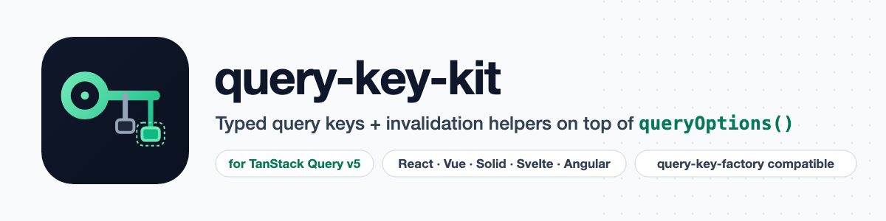

  <picture>
    <source media="(prefers-color-scheme: dark)" srcset="art/banner-dark.png">
    
  </picture>

# query-key-kit: typed query keys for TanStack Query v5

A typed query-key hierarchy and invalidation helpers on top of `queryOptions()`, for React, Vue, Solid, Svelte and Angular Query. A maintained successor to `@lukemorales/query-key-factory`.

> **Status:** in development. Nothing is published to npm yet.

## Need this built into your app, or something custom?

[Get in touch](https://amjad.com.pk/contact?utm_source=github&utm_medium=readme&utm_campaign=query-key-kit).

## License

MIT. See [LICENSE.md](LICENSE.md).
